 

**AI 编程开发者 · AI-assisted developer**

使用 AI 编程，把想法做成作品。也喜欢 MyGO!!!!! 和千早爱音。

常用技术：Go · Java · HTML · CSS · JavaScript · Vue · Python · Rust

[GitHub](https://github.com/jibanso) · [Repositories](https://github.com/jibanso?tab=repositories) · [MyGO!!!!!](https://bang-dream-gbp-en.bushiroad.com/mygo/)

 

 

 

<picture>
  <source media="(prefers-color-scheme: dark)" srcset="https://raw.githubusercontent.com/jibanso/jibanso/output/contributions-dark.svg">
  <source media="(prefers-color-scheme: light)" srcset="https://raw.githubusercontent.com/jibanso/jibanso/output/contributions.svg">
  
</picture>

千早爱音插画来自 <a href="https://bang-dream-gbp-en.bushiroad.com/mygo/">BanG Dream! 官方 MyGO!!!!! 特设站</a>。个人开发者主页 / Fan profile.

